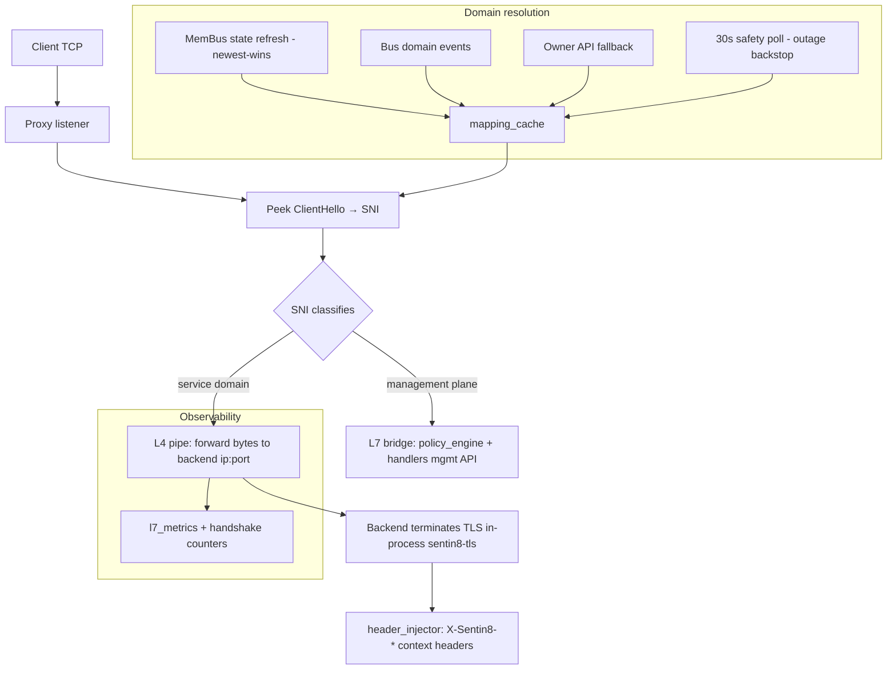

# Design Doc: Sentin8:Proxy - Single Ingress (L4 SNI Router + L7 Bridge)

## 1. Summary

Sentin8:Proxy is the platform's single ingress: every external
connection terminates here. It routes TLS by SNI at L4 (raw TCP pipe
to the owning service, which terminates TLS in-process via the shared
`sentin8-tls` library), bridges to an L7 HTTP/2 reverse-proxy for
management-plane paths, injects authoritative `X-Sentin8-*` context
headers (stripping client-supplied copies), resolves domains via the
membus → bus → owner-API chain, exposes the Shield route-path
policy engine for L7 control, and (optionally) binds a plain-HTTP
`:80` listener whose only purpose is forwarding
`/.well-known/acme-challenge/*` to acme - the ingress path for
upstream CA HTTP-01 validation (acme DESIGN §4.3).

## 2. Motivation

- **One door, one guard.** A single ingress means one place to enforce
  TLS posture (post-quantum key exchange exclusively, ML-DSA
  signatures), one place to terminate, and one place to observe every
  inbound connection.
- **Services own their TLS.** The proxy is an SNI router, not a TLS
  terminator for application traffic: it routes the encrypted bytes to
  the backend, which terminates TLS in-process (certificate resolver,
  per-service certs from Acme). Proxy never sees application plaintext.
- **Context headers are authoritative.** Backends read `X-Sentin8-*`
  for tenant resolution; Proxy injects them from the SNI identity and
  strips client-supplied copies - no header spoofing.
- **Domain data must be live.** Service DNS names (created/updated via
  sys) resolve through membus state refreshes, bus events, and owner
  API fallback - a 30s safety poll is the outage backstop.

## 3. Architecture & High-Level Design

- **L4 path** - SNI-parsed ClientHello → backend registry lookup → raw
  TCP pipe; the backend presents its own certificate (per-service,
  Acme-issued) and does its own tenant resolution from the injected
  headers.
- **L7 path** - management-plane routes (health, stats) terminate at
  the proxy itself; the route-path policy engine (Shield-evaluated)
  can block requests before handlers.
- **Bootstrap certificate** - the proxy self-issues a short-lived
  certificate for its own hostname at boot (chicken-and-egg breaker,
  same as every service).
- **Upstream TLS** - service-to-service connections use the shared PQ
  TLS stack (X25519MLKEM768, ML-DSA-65; no classical fallback).
- **Upstream connection pooling (L7)** - L7 upstream sessions are
  pooled per (backend, SNI) and reused across requests : a
  warm pooled connection removes the ~40 ms PQ handshake from proxied
  requests; a stale pooled connection (backend respawned) fails the
  request write once and the request retries on a fresh connection.
- **Traffic split** - IPv4/IPv6 handling with local/private address
  detection for backend selection.

## 4. Key Traits and Data Structures

- **`BackendRegistry`** - the Valkey-backed map of service →
  instances (ip:port, status); only `Active` instances receive
  traffic; round-robin selection per service.
- **`DomainResolver`** - resolves hostname → backend using the
  membus-first chain; caches in `mapping_cache` with invalidation on
  domain-changed notifications. Its `sys.*` reads
  (`organizations`, `environments`, `app_instances`,
  `vertical_services`) are declared `SELECT` grants in
  `registration.rs` (`cross_schema_grants`) - the subdomain map rides
  `sys.vertical_services`, the deduction rows ride the lifecycle tables.
- **`Sni`** - ClientHello parser extracting the SNI extension without
  full TLS termination.
- **`HeaderInjector`** - injects `X-Sentin8-Env-Id` / `X-Sentin8-App-Id`
  / org context headers and strips client-supplied copies (the
  platform's anti-spoofing boundary).
- **`L7Metrics` / `L7MetricsSnapshot`** - per-(service, status) request
  counts, latency aggregates, handshake errors, policy blocks, and the
  upstream warm/cold/stale-retry counters (pool health).
- **`UpstreamPool`** - the idle upstream-connection pool :
  per-(backend_addr, sni) warmed TLS/TCP sessions handed out before a
  fresh connect; one pooled connection serves one request (no
  pipelining); 30s idle eviction + a 1-connection-per-backend cap.
- **`L7ConnectionGauge` / `L7ConnectionGuard`** - the in-flight L7
  connection gauge (`AtomicUsize`, relaxed ordering): incremented at
  `handle_l7_connection` entry, decremented by the RAII guard on every
  exit path. Exposed as `active_connections` in the management health
  payload - the drain signal captain polls during rolling upgrades.
- **`PolicyEngine`** - route-path allow/deny rules evaluated per L7
  request (Shield-gated admin surface to manage them).

## 5. Rationale, Trade-offs, and Alternatives

- **SNI passthrough (L4) for application traffic.** The backend
  terminates TLS in-process with its own certificate - the service
  knows its own identity, holds its own key, and injects context
  headers itself. A terminating proxy would centralize all
  application keys in Proxy (a single compromise domain) and add a
  decryption hop.
- **L7 bridge only for management paths.** The management API
  (`/v1/proxy/*`, Shield policy-admin) needs L7 (routing, policy,
  body handling); application traffic stays L4. A full L7 proxy for
  everything would couple Proxy to every upstream protocol.
- **Header injection at the edge.** Proxy strips client-supplied
  `X-Sentin8-*` copies and injects authoritative ones - backends never
  do hostname-based tenant resolution. This is the single enforcement
  point; per-service stripping would be N places to forget.
- **Domain resolution order: membus → bus → owner API.** The access
  decision order mirrors the platform's service-communication rule:
  in-memory state refresh is fastest (newest-wins), bus events cover
  updates, the owner API is the authoritative fallback, and a 30s
  safety poll is the outage backstop so a stale mapping never strands
  traffic.
- **Bootstrap cert self-issuance.** The proxy needs TLS to fetch its
  own certificate from Acme; the self-issued bootstrap cert (24h)
  breaks the cycle exactly like every other service's.
- **Registry in Valkey.** Instance state changes on captain events;
  the registry is shared with the fleet store (one source of truth),
  and TTLs give crash detection.
- **Round-robin per service.** Even load across `Active` instances;
  failed handshakes mark instances degraded (cooldown) rather than
  removing them permanently (a restarted instance recovers).
- **Idempotent single-request pool vs connection multiplexing.** The
  L7 pipe is connection-per-request (HTTP/1.0-style byte piping); the
  pool therefore hands off a WARM session without pipelining a second
  request onto a busy socket - correctness (no cross-request
  interleaving) for the price of one warm buffer per backend.
- **Rejected: nginx/envoy as ingress.** The proxy is PQ-TLS-native
  (X25519MLKEM768 + ML-DSA-65, no classical fallback) and shares the
  platform's header/context semantics; an external proxy would need a
  custom TLS stack patch or a downgrade.
- **Rejected: terminating L7 proxy for all traffic.** See L4 rationale
  - keys and plaintext at the edge is the attack surface the design
  avoids.

## 6. Internal Implementation & Invariants (Private Design)

- **Invariants:**
  - Proxy is the ONLY ingress - no service binds a public port;
    SNI is the routing key.
  - Client-supplied `X-Sentin8-*` headers are ALWAYS stripped before
    forwarding; only Proxy-injected context survives.
  - Only `Active` registry instances receive traffic; `Draining`
    instances finish in-flight connections and are excluded from
    new picks.
  - Post-quantum TLS exclusively: X25519MLKEM768 key exchange, ML-DSA-65
    signatures, SLH-DSA root CA - no classical fallback, ever.
  - ACME challenge passthrough is handled before registry lookup (the
    challenge target may not be a registered backend yet).
  - The optional `:80` plain-HTTP listener (`SENTIN8_PROXY_HTTP_PORT`)
    serves ONLY `/.well-known/acme-challenge/*` (forwarded to acme);
    every other request is a fixed `404`. Unset = the listener is
    not bound (the external-upstream issuance path is disabled).
  - L7 metrics never include payload bytes (counts, statuses, timings
    only).
  - The management listener binds before spawning so `make status`
    works while services start.
  - The client-certificate posture (`SENTIN8_MTLS_CLIENT_AUTH`,
    DESIGN 9a.12): `off` (default) requests no client certificate;
    `self_signed` requests one and accepts ANY presented cert at the
    handshake - the RFC 8705 trust decision ALWAYS stays in the
    backend (Sentin8:Auth binds the forwarded cert's thumbprint
    against the registration row; an unregistered cert authenticates
    nothing). The presented leaf is forwarded as base64
    `X-Sentin8-Client-Cert`; client-supplied copies of that
    header are stripped first.
- **Boot.** Self-issued bootstrap certificate → backend registry load →
  domain resolver (membus consumer + bus consumer + safety poll) →
  Shield boot (one engine, shared with the policy-admin API) →
  listeners (public TLS + management + optional :80 challenge).
- **Pipe.** The L4 path is a bidirectional copy loop after handshake
  classification; no per-byte inspection - throughput is memory-copy
  bound.

## 7. Unresolved Questions / Future Designs

- HTTP/3 (QUIC) ingress is a non-goal until a client needs it: the
  post-quantum TLS stack has no mature QUIC integration; revisit when rustls'
  QUIC support meets the PQ requirement.
- Per-domain rate limiting reuses the existing token bucket with a per-host
  key (`(env_id, host)` instead of a global key).
- mTLS client-certificate forwarding sends the verified client cert as a
  base64 `X-Sentin8-Client-Cert` header.

---

**Architecture & Design:** sentin8:proxy and its underlying concepts were designed by [Hamid Jahanzad](https://www.linkedin.com/in/hamidjahanzad/).
